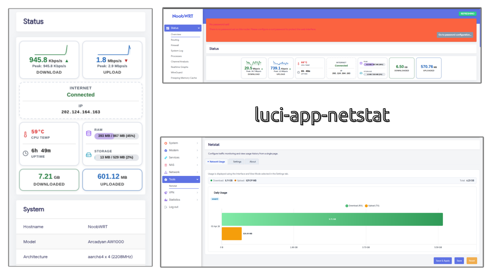

# luci-app-netstat

<div align="center">

**A professional network statistics application for OpenWrt LuCI**

[](LICENSE)


[Features](#features) • [Installation](#installation) • [Usage](#usage) • [Development](#development) • [License](#license)

</div>

---

## Overview



**luci-app-netstat** is a modern, feature-rich LuCI application that provides comprehensive network traffic statistics and monitoring for OpenWrt routers. Traffic history comes from **vnStat 2** (`vnstat2` package, read through `vnstat --json`), and live rates come from the kernel counters in `/proc/net/dev`.

It works on any OpenWrt router: there are no hard-coded interface names, device paths or board-specific files. The uplink is found from the default route, and vnStat is set up to track the router's interfaces automatically.

The application offers real-time network statistics, historical data visualization, and detailed traffic analysis to help you understand your network usage patterns.

## Features

✨ **Core Features:**
- 📊 **Real-time Network Monitoring** - Track network traffic with live statistics
- 📈 **Traffic Visualization** - Interactive charts powered by Chart.js
- 📅 **Historical Data** - Monitor trends over days, weeks, months, and years
- 🎨 **Dark Mode Support** - Professional dark theme for comfortable usage
- 📱 **Responsive Design** - Works seamlessly on desktop and mobile devices
- ⚙️ **Easy Configuration** - Simple UCI-based configuration system
- 🔄 **Automatic Updates** - Uses vnstat for continuous data collection

## Requirements

- OpenWrt with LuCI installed (`luci-compat` is pulled in automatically)
- **`vnstat2`** (vnStat 2.x) — required, installed automatically as a package dependency. The old vnStat 1.x `vnstat` package is no longer supported.
- Modern web browser (Chrome, Firefox, Safari, Edge)

## Installation

### Automatic Installation

Clone the repository and install using the OpenWrt build system:

```bash
git clone https://github.com/dotycat/luci-app-netstat.git
cd luci-app-netstat
make
```

### Manual Installation

1. Download the latest `.ipk` package from [Releases](../../releases)
2. Upload to your router via SCP:
   ```bash
   scp luci-app-netstat_*.ipk root@<router-ip>:/tmp/
   ```
3. Install via SSH:
   ```bash
   ssh root@<router-ip>
   opkg install vnstat2
   opkg install /tmp/luci-app-netstat_*.ipk
   ```
   (On OpenWrt 25.x use `apk add` with the `.apk` package instead.)
4. The live widget appears on **Status** → **Overview**; history and settings are under **Tools** → **Netstat**

## Configuration

### UCI Configuration

Settings live in `/etc/config/netstats` and can be changed on the **Settings** tab:

```
config config
    option prefer ''            # '' = auto (default-route device), or a device (eth1) / logical interface (wan)
    option backend 'normal'     # 'normal' = since-boot totals, 'vnstat' = this month's totals from vnStat
    option mode 'daily'         # default Network Usage view: 'daily' or 'monthly'
    option vnstat_autoadd '1'   # '0' stops the app from adding interfaces to vnStat
```

### How interfaces are found

- **Live widget:** the `prefer` setting if it resolves, otherwise the device that holds the default route (read from `/proc/net/route` and `/proc/net/ipv6_route`). Logical names such as `wan` are resolved to their device through `ubus call network.interface.<name> status`.
- **Network Usage tab:** the same choice, limited to interfaces in the vnStat database (`vnstat --dbiflist 1`).
- **vnStat tracking:** OpenWrt's `vnstat2` starts `vnstatd` with `--noadd`, so it only tracks the interfaces listed in `/etc/config/vnstat`. This app adds them for you:
  - `/etc/hotplug.d/iface/90-netstat-vnstat` adds each interface's device to that list when it comes up (WAN, LAN, LTE modem, PPPoE, VPN, ...);
  - `/etc/uci-defaults/50_luci-netstat` does the same once at install time for interfaces that are already up;
  - you can run `/usr/libexec/netstat-vnstat-track` by hand at any time.

### vnStat notes

- vnStat writes to its database every few minutes (`SaveInterval`, 5 by default), so a newly added interface shows "No data available" for a short while.
- OpenWrt's default database location is `/var/lib/vnstat`, which is in RAM, so **history is lost on reboot**. To keep it, set `DatabaseDir` in `/etc/vnstat.conf` to persistent storage (e.g. a USB disk or `/etc/vnstat` if you accept the flash writes) and run `service vnstat restart`. The Settings tab shows the current location.

## Usage

### Dashboard

1. Log into your OpenWrt LuCI web interface
2. **Status** → **Overview** shows live download/upload rates, totals, IP and system info
3. **Tools** → **Netstat** shows daily or monthly history from vnStat

### Available Data

- **Current Usage** - Real-time traffic rates
- **Daily Statistics** - Traffic breakdown by day
- **Monthly Analysis** - Monthly usage overview

## Dark / Light Theme Switching

The NoobWRT theme stores the user's theme preference in **`localStorage`** under the key `luci-theme` (`'dark'` or `'light'`). When dark mode is active the theme also adds the class `dark-theme` to `document.body`.

`tabs.htm` (rendered on every Netstat tab) reads this value at page load:

```js
var isDark = localStorage.getItem('luci-theme') === 'dark'
          || document.body.classList.contains('dark-theme');
```

If dark mode is detected, a `<style>` block is injected into the page with `!important` overrides for every `.netstat-*` class. This covers:

| Selector | Dark value |
|---|---|
| `.netstat-dashboard` | `#1a1d20` background |
| `.netstat-summary` | `#111315` background |
| `.netstat-chart-wrap` | `#1a1d20` background |
| `.netstat-about-card` | `#1a1d20` background |
| `.netstat-chart-title`, `.netstat-summary-item` | `#f3f4f6` text |
| `.netstat-summary-label`, `.netstat-about-label` | `#9ca3af` text |
| `.netstat-about-row a` | `#60a5fa` link color |

The same flag (`window._netstatDark`) is passed to Chart.js so axis labels and grid lines also use dark-friendly colors.

No server-side detection or separate CSS files are needed — everything is driven by the single `localStorage` value the theme toggle button already sets.

## Credits

- **Original Development**: [SMALLPROGRAM](https://github.com/smallprogram)
- **Maintenance**: [nooblk-98](https://github.com/nooblk-98/)


## Contributing

Contributions are welcome! Please feel free to:
- Report bugs and issues
- Submit feature requests
- Create pull requests with improvements
- Improve documentation

## Support

For support, issues, or questions:
- Open an [Issue](../../issues) on GitHub
- Check existing [Discussions](../../discussions)
- Contact: liyanagelsofficial@gmail.com

---

<div align="center">

**Made with ❤️ for the OpenWrt Community**

</div>
